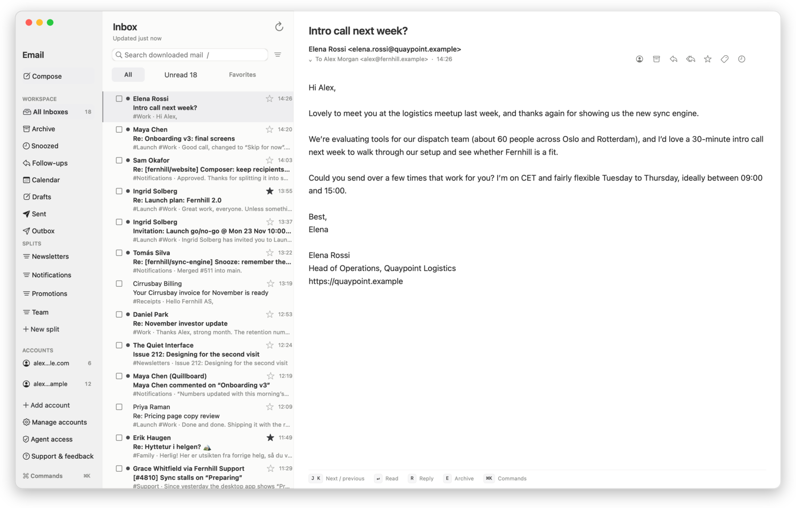
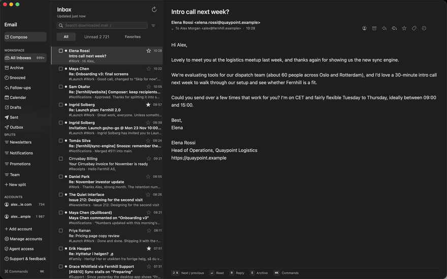
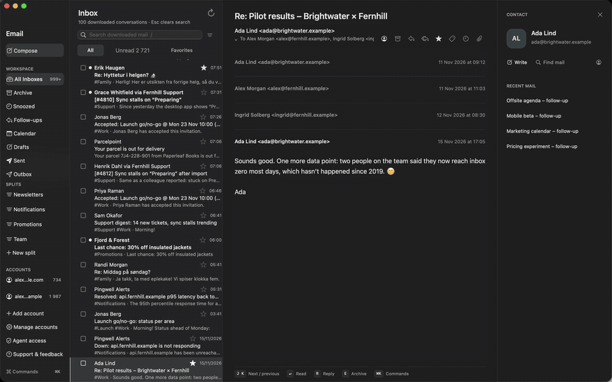
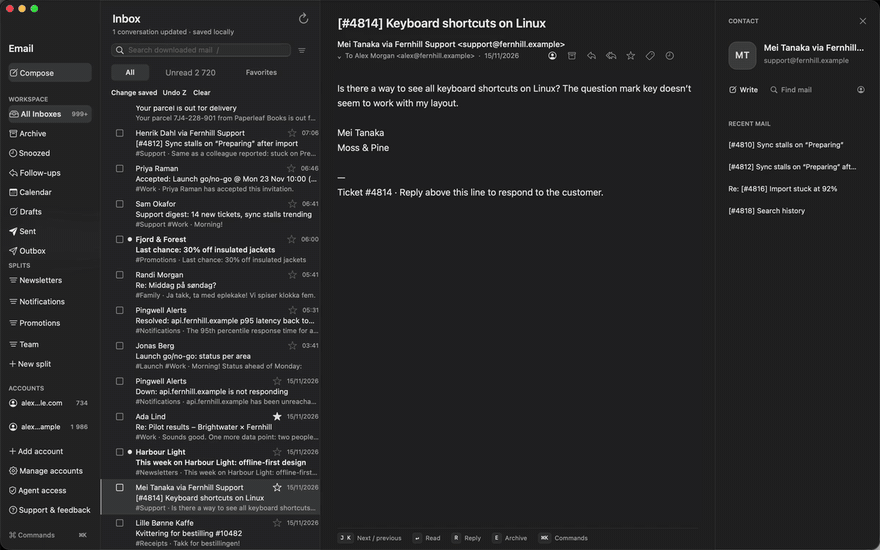
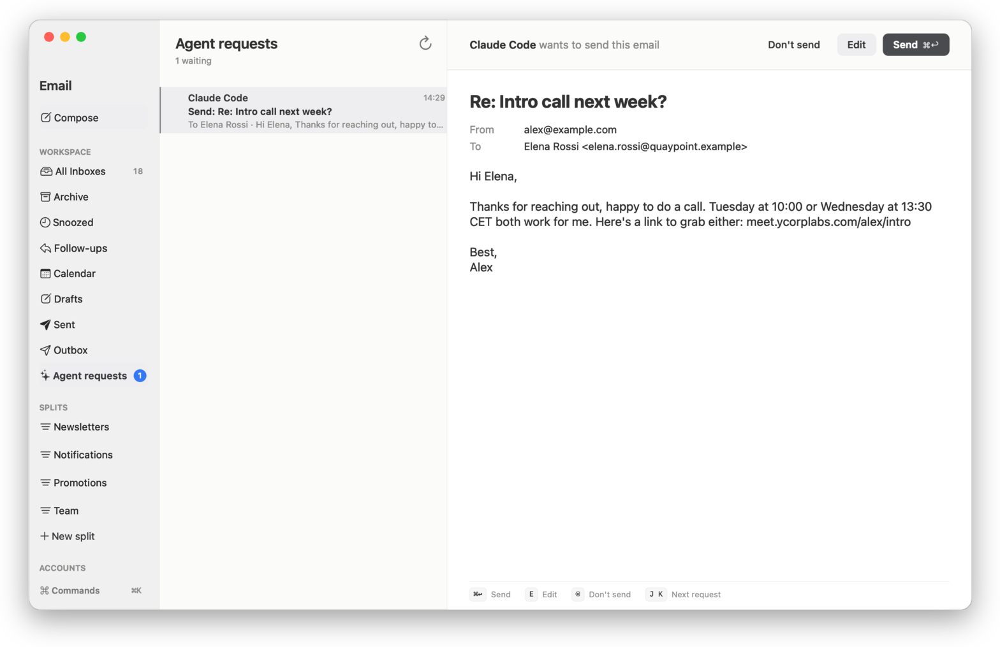

<p align="center">
  
</p>

<h1 align="center">Email by YCorp</h1>

<p align="center">A fast, keyboard-first email client for macOS and Linux.</p>

<p align="center">
  <a href="https://ycorplabs.com/email/download/"><b>Download</b></a> ·
  <a href="https://ycorplabs.com/email/">Website</a> ·
  <a href="docs/README.md">Docs</a> ·
  <a href="docs/mcp.md">Agent access</a> ·
  <a href="SUPPORT.md">Support</a>
</p>

<p align="center">
  <picture>
    <source media="(prefers-color-scheme: dark)" srcset="assets/readme/hero-dark.png">
    
  </picture>
</p>

Email keeps your mail on your own computer, so search is instant and the app
never waits on a server. Both apps are native, AppKit on macOS and GTK 4 on
Linux, and share one Rust engine that talks straight to Gmail, iCloud or any
IMAP account.

Your AI agents can work with your mail too, through a local MCP server. Every
account is off until you turn it on, and anything an agent wants to send waits
for your approval.

> [!WARNING]
> **It's a beta.** Gmail on macOS is what's been tested most; other providers
> and plenty of edge cases still need real-world testing. Keep important mail
> on your provider, and expect things to break now and then.

## A quick look

**Search everything you've downloaded.** It runs on your computer, across
every account.



**Triage from the keyboard.** `j` and `k` move, `e` archives, `s` snoozes.



**Everything else is in the command palette.** `⌘K` on macOS, `Ctrl+K` on
Linux.



**Agents ask before they send.** When an agent wants to send an email, it waits
under Agent requests until you send, edit or drop it.

<picture>
  <source media="(prefers-color-scheme: dark)" srcset="assets/readme/agents-dark.png">
  
</picture>

## Features

- Fast keyboard navigation: `j`/`k`, `m`/`u` read state, `e` archive, `/`
  search, `⌘K`/`Ctrl+K` command palette, and a reader mode with Vim-style
  scrolling.
- Gmail, iCloud and any IMAP/SMTP account. Microsoft accounts are in the
  engine but untested, so they're off for now.
- Full-text search of downloaded mail, labels, saved split inboxes, snooze,
  follow-ups, snippets and signatures.
- Inline reply that keeps the conversation visible, attachments, and scheduled
  send with undo. Undo cannot recall mail after the provider accepts it.
- A confirmable unsubscribe action (`⌘U` on macOS, `Ctrl+Shift+U` on Linux).
- A calendar view for Google calendars. It needs Google sign-in, which the
  beta builds don't have yet.

## Install

Download the latest beta from
[ycorplabs.com/email/download](https://ycorplabs.com/email/download/) or
[Releases](https://github.com/YCorpLabs/Email/releases). After that, Email
keeps itself up to date.

- **macOS** (Apple Silicon, macOS 13 or later): open the `.dmg` and drag
  Email to Applications. It's notarized by Apple. New versions come through
  **Email › Check for Updates…**.
- **Ubuntu 24.04 or later** (x86_64 or ARM64): install the `.deb` with
  `sudo apt install ./email-linux_<version>_amd64.deb` (`_arm64.deb` on ARM).
  It adds Email's package repository, so `sudo apt upgrade` brings new
  versions. [Linux updates](docs/linux-updates.md) has the details.
- **Arch Linux** (x86_64 or aarch64): add the signed `[ycorp]` repository
  once, then `sudo pacman -Syu email-ycorp-bin`. The setup is in
  [Arch Linux updates](docs/arch-updates.md).

## Build from source

```sh
./scripts/dev.sh
```

This builds the app for macOS or a Linux desktop and opens it with demo
messages in an isolated store, `dist/demo/mail.sqlite`. It needs no signing
identity, OAuth client or mail account, and never opens a real mail store. From
any computer with Docker, `./scripts/build-linux-container.sh` builds a Linux
binary.

Builds from source use the `unofficial`
[distribution profile](docs/distribution-profile.md): their own app ID,
Keychain items and data folder, so they never clash with an official install.
They come without an OAuth client, support address, Scheduling service or
update feed until you add your own.

- [Building and running Email](docs/building.md): requirements, the signed
  macOS app, Linux packages, demo mode, tests and common errors.
- [FORKING.md](FORKING.md): your own Google OAuth client for Gmail sign-in, and
  shipping a build under your own name. iCloud and IMAP accounts need no
  registration; they use an app password.

## Privacy and security model

- **Local-first:** mail, drafts and the search index live in a local SQLite
  database in a directory only your user can read. Email talks directly to your
  provider.
- **Credentials:** passwords and OAuth tokens are stored in the operating
  system's vault, the macOS Keychain or the Linux Secret Service. Account
  configuration files hold server names, usernames and the OAuth client used,
  including a Google desktop client's token-exchange value, which desktop apps
  cannot keep confidential.
- **Safe rendering:** message HTML is sanitized and shown with JavaScript
  disabled, navigation blocked and a restrictive content security policy.
  Remote images are blocked by default: the reader says so above the message
  and offers **Load images** for that email, while `i` or the image control
  changes the remembered default. Loading them can tell a sender when you
  opened a message. Bounded `cid:` images from the same message still render.
- **Bounded input:** IMAP messages, attachments, Gmail text decoding and sync
  cursors use size limits and staged storage, so malformed or oversized mail
  cannot stall sync or exhaust memory.
- **Other network requests:**
  - booking links appear only after you connect Scheduling in Manage
    accounts. They use the Scheduling service named by the build's profile;
    builds without one don't offer it. Per-draft open tracking exists only in
    development-profile builds; official and unofficial builds compile it out
    ([reader privacy](docs/reader-privacy.md));
  - Google contact photos are opt-in;
  - the macOS app looks up published BIMI logos for organization senders by
    DNS and HTTPS, whatever the remote-image setting;
  - signed official macOS releases check for updates with your permission.
- **No telemetry:** no analytics and no automatic crash reports.

See [SECURITY.md](SECURITY.md) to report a vulnerability.

## MCP permission model

Email includes a local MCP server so AI tools such as Claude Code and Codex
can work with your mail. In the app, **Agent access** connects them
(**Connect**) and decides what they may do.

- It is a **local stdio process** started by your client, not a network
  service.
- **Every account is off** until you turn it on in Agent access: Read only
  by default, or Read and organize, or Read, organize and write.
- **Sends and bulk changes wait for you**: they appear under Agent requests
  in the main window, showing the email as it will go out, and happen only
  when you approve them, with the usual undo window.
- Mail content reaches agents labelled as untrusted.

From a source checkout, `./scripts/connect-mcp.sh` registers the server
instead. Its registration is read-only by default; `--allow-draft`,
`--allow-triage`, `--allow-sync`, `--allow-send` (or `--allow-write`) widen it,
and `--account` limits it to specific accounts. The registration's flags and
the in-app permissions both apply. Scheduling settings need the separate
`--allow-booking-settings` and browser approval.

See [docs/mcp.md](docs/mcp.md) for the tool list and limits.

## How it's built

A Rust engine (`crates/`) handles accounts, sync, the SQLite cache, search and
sending, and the local MCP server. The macOS app (`apps/macos`, AppKit) and the
Linux app (`apps/linux`, GTK 4) are thin native shells on top of it.
[Where things live](docs/building.md#where-things-live) maps the source, and
[architecture](docs/architecture.md) covers the rules the engine follows.

## Contributing, support and forks

- [CONTRIBUTING.md](CONTRIBUTING.md): how to contribute.
- [docs/building.md](docs/building.md) and the [documentation index](docs/README.md):
  building, testing, demo mode and how the engine fits together.
- [SUPPORT.md](SUPPORT.md): where to ask questions and report bugs.
- [FORKING.md](FORKING.md): ship your own build with your own name, OAuth
  clients, support channels and update feed.

## License and trademarks

MIT, see [LICENSE](LICENSE). The YCorp name and logo aren't part of that; see
[TRADEMARKS.md](TRADEMARKS.md). Dependencies keep their own licenses
([THIRD_PARTY_NOTICES.md](THIRD_PARTY_NOTICES.md)).
